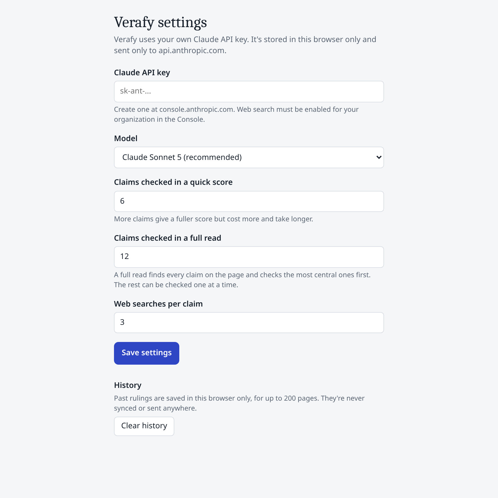
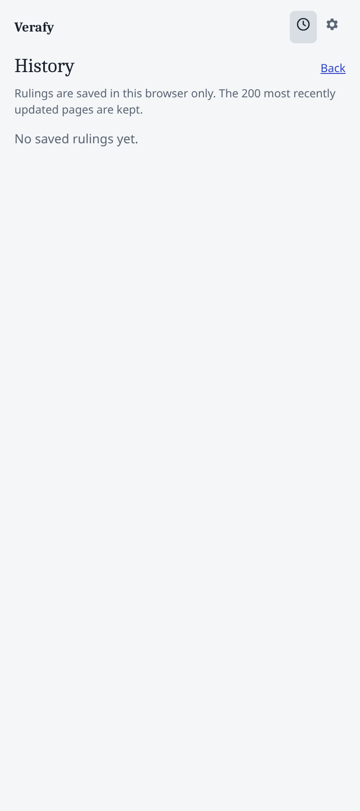

# Verafy Fact-Checker for Chrome

**Verafy: Truth Check** is a Chrome side panel that reads any page with a truth filter. It finds every checkable claim, highlights each one in place, and checks the most central ones against independent sources. It also writes cliff notes for the page and shows which perspectives are present and which are missing.

It's one of three Verafy products:

| Product | What it checks | Where |
|---|---|---|
| **Fact-Checker** (this repo) | The claims on the page you're reading | Install unpacked (below) |
| **Swarm Explorer** | One question across many language models | https://swarm.verafy.ai |
| **Bias Detector** (beta) | Where each model leans on 565 contentious questions | https://bias.verafy.ai |

Announcement: https://blog.verafy.ai/articles/20261011-introducing-verafy-fact-checker


## Status

- Current release: **v0.2.1** in [`releases/v0.2.1`](releases/v0.2.1). Not yet in the Chrome Web Store.
- v0.3.0 (source panel) is in progress in [`releases/v0.3.0`](releases/v0.3.0). v0.4 (multi-model debate) is specced in [`specs/`](specs).
- Today the extension calls Claude directly with **your own API key**, stored in the browser. A public release will route calls through the Verafy backend and use a multi-company model panel instead of one model.

## Install (developer mode)

1. Clone or download this repo.
2. Open `chrome://extensions` and turn on **Developer mode**.
3. Click **Load unpacked** and choose `releases/v0.2.1`.
4. Click the Verafy icon to open the side panel, open **Settings**, and paste your Claude API key. Web search must be enabled for your organization in the Claude Console.

## Modes

- **Read the whole page:** maps the page into sections, finds up to 40 claims, highlights them, and checks the most central (12 by default). Tabs for **Claims**, **Cliff notes**, and **Perspectives**.
- **Quick score:** checks the page's main claims only (6 by default). No highlights.
- **One statement:** select text, right-click, **Check with Verafy**.

Highlight colors: green supported, amber contested, red refuted, grey dotted for can't verify or not checked yet.

## How verdicts are made

1. **Argue.** For each claim the model searches the web (the page's own site is blocked) and writes arguments for and against, each quoting a search result.
2. **Filter.** Arguments whose source wasn't actually returned by the search are dropped.
3. **Solve.** The model marks which arguments attack which; [`grounded.js`](releases/v0.2.1/grounded.js) decides what survives using grounded semantics. The model never picks the verdict.
4. **Score.** Supported = 1, contested = 0.5, refuted = 0, weighted by centrality. Unverifiable claims are excluded and counted.

Cliff notes and perspectives are the model's reading of the page and never affect the score.

## Saved rulings and history

Every ruling is saved in `chrome.storage.local`, one per page (200 pages kept). Returning to a page restores the ruling and highlights with no API calls. Nothing leaves the browser.

| Settings | History |
|---|---|
|  |  |

## Tests

```
cd releases/v0.2.1
node test_grounded.mjs && node test_history.mjs && node test_pageurl.mjs && node test_progress.mjs
```

## Repo layout

```
releases/        frozen extension versions (v0.1.0 to v0.3.0) and CHANGELOG.md
specs/           extension specs (v0.2 handoff, v0.3 source panel, v0.4 debate/discussion)
research/        method cards and candidate aggregators
data/            decision records and the frozen gold set
docs/            screenshots; engine-README.md describes the decision-engine plan
verafy-extension.zip, verafy-v0.2-bundle.zip   original zips as found
```

## Security

No API keys or secrets are committed. The extension keeps the user's key in browser storage and sends it only to api.anthropic.com.
